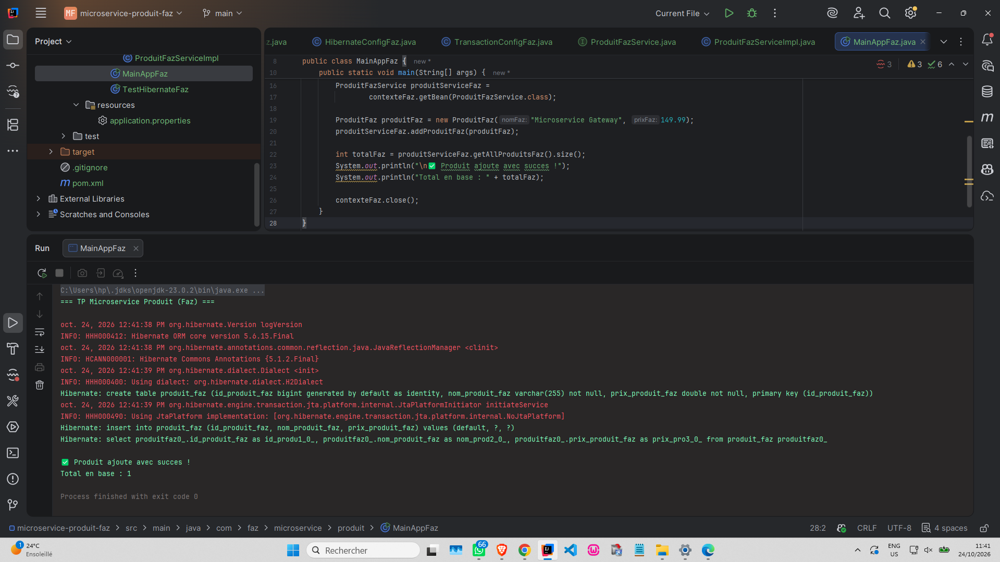
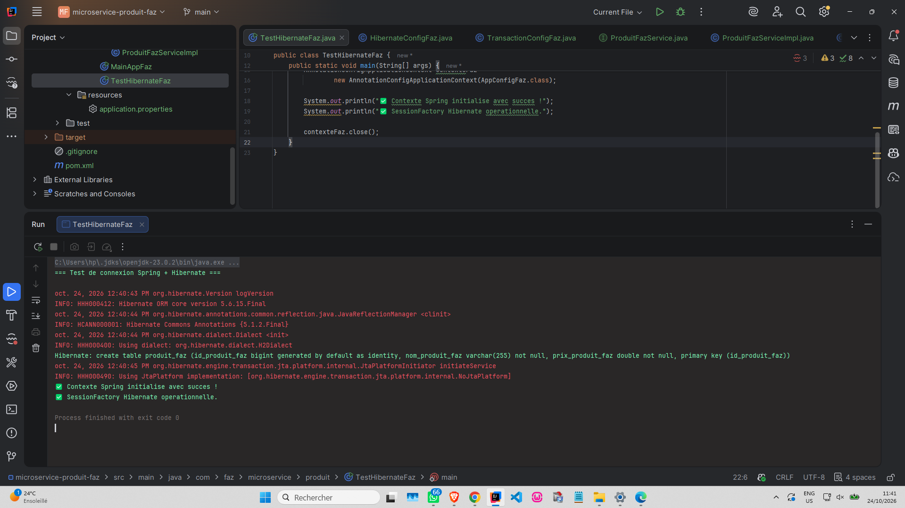

# Microservice Produit (Faz)

TP d'intégration **Spring + Hibernate** : gestion d'un catalogue de produits avec une couche DAO, une couche service transactionnelle et une base **H2** en mémoire.

## Technologiesgit

| Outil | Version |
|---|---|
| Java (JDK) | 21 |
| Spring (context, orm, jdbc, tx) | 5.3.39 |
| Hibernate Core | 5.6.15.Final |
| Base de données | H2 2.1.214 (en mémoire) |
| Gestion de projet | Maven |

## Architecture

```
MainAppFaz
    │
    ▼
ProduitFazService  (interface, @Transactional)
    │
    ▼
ProduitFazServiceImpl
    │
    ▼
ProduitFazDao  ──►  SessionFactory (Hibernate)  ──►  H2
```

## Structure du projet

```
microservice-produit-faz
├── imgggg/                      # Captures d'écran du README
├── src/main/java/com/faz/microservice/produit
│   ├── config/
│   │   ├── AppConfigFaz.java            # Configuration principale (scan des composants)
│   │   ├── HibernateConfigFaz.java      # DataSource + SessionFactory
│   │   └── TransactionConfigFaz.java    # Gestionnaire de transactions
│   ├── entity/ProduitFaz.java           # Entité JPA
│   ├── service/                         # Interface + implémentation du service
│   ├── MainAppFaz.java                  # Programme principal
│   └── TestHibernateFaz.java            # Test de la configuration
└── pom.xml
```

## Lancer le projet

1. Cloner le dépôt et l'ouvrir dans IntelliJ IDEA.
2. Recharger Maven (**Reload All Maven Projects**).
3. Exécuter la classe `MainAppFaz` (ou `TestHibernateFaz` pour tester la configuration seule).

## Résultats

### 1. Programme principal : `MainAppFaz`



> **Commentaire :** la console montre le déroulement complet de l'application.
> - Hibernate démarre et utilise le dialecte `H2Dialect`.
> - La table `produit_faz` est générée automatiquement à partir de l'entité `ProduitFaz`.
> - Le produit est enregistré (`insert into produit_faz ...`), puis relu (`select ... from produit_faz`).
> - Le message `Total en base : 1` confirme que l'insertion et la lecture fonctionnent, avec la transaction gérée par Spring.

### 2. Test de la configuration : `TestHibernateFaz`



> **Commentaire :** ce test vérifie uniquement que la configuration est correcte, sans insérer de données.
> - `Contexte Spring initialise avec succes` : tous les beans (DAO, service, `SessionFactory`, gestionnaire de transactions) sont créés.
> - `SessionFactory Hibernate operationnelle` : la connexion à H2 et le mapping de l'entité sont valides.
> - Le programme se termine avec le code `0`, sans erreur.

## Remarques

- La base H2 est **en mémoire** (`jdbc:h2:mem:testdb`) : les données disparaissent à chaque arrêt du programme.
- Le service est récupéré via son **interface** (`ProduitFazService`) et non sa classe d'implémentation, car Spring l'enveloppe dans un proxy transactionnel.

## Auteur

Fatima Zohra